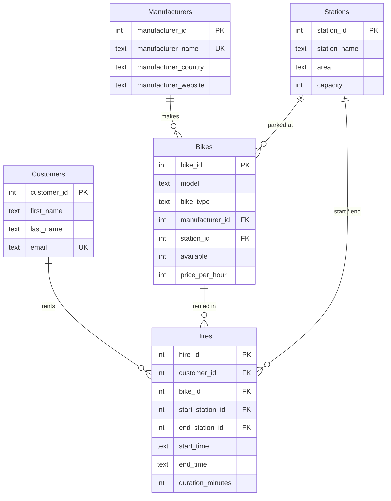

# 🚲 Bike Rental Database: Migration to 3NF

A Python + SQLite project that takes a bike rental database with a design flaw,
normalizes it to **Third Normal Form**, and migrates all data into the new design.
The migration can be run again and again safely, and a built-in search menu proves
that the old and the new database return the same results.

## The problem

In the original database, every bike row also stores its manufacturer's country and website:

| bike_id | model | manufacturer_name | manufacturer_country | manufacturer_website |
|---|---|---|---|---|
| 1 | Orange C7 | Gazelle | Netherlands | gazelle.com |
| 2 | Ultimate T10 | Gazelle | Netherlands | gazelle.com |
| 3 | FX 2 | Trek | USA | trekbikes.com |

Country and website depend on the **manufacturer**, not on the bike:

```
bike_id → manufacturer_name → manufacturer_country, manufacturer_website
```

This *transitive dependency* breaks 3NF and causes three anomalies:

- **Update anomaly** – change Gazelle's website in one row, forget another, and the data contradicts itself.
- **Delete anomaly** – delete a manufacturer's last bike and the manufacturer's information is gone too.
- **Insert anomaly** – a manufacturer cannot be added before it has a bike.

## The solution

Manufacturers get their own table; `Bikes` only keeps a foreign key.



## Key features

- **Re-runnable migration (UPSERT)** – every insert uses `INSERT ... ON CONFLICT DO UPDATE`.
  New rows in the old database are added, changed rows are updated, and running the
  script twice never creates duplicates. I chose this over `INSERT OR IGNORE` (skips
  changed rows) and `INSERT OR REPLACE` (deletes and re-inserts the row).
- **Name → ID translation** – a `{manufacturer_name: manufacturer_id}` dictionary is built
  *after* inserting manufacturers, so every bike can point to the right ID.
- **Foreign keys enforced** – `PRAGMA foreign_keys = ON`, and tables are filled parent-first (Stations, Customers, Manufacturers → Bikes → Hires).
- **All-or-nothing transaction** – if anything fails, `rollback()` leaves no half-migrated database.
- **Parameterized queries (`?`)** – user input never becomes part of the SQL text, which prevents SQL injection.
- **Old vs new comparison** – each search runs on both databases and reports whether the results match.
- **Crash-safe menu** – wrong input (e.g. letters as a bike ID) shows a message instead of an error.

## Example

```
Migration finished. New rows added per table:
  Stations: +5 (total 5)
  Customers: +40 (total 40)
  Manufacturers: +5 (total 5)
  Bikes: +30 (total 30)
  Hires: +150 (total 150)

=== Model 'Orange' ===
Old database: [('Orange C7', 21)]
New database: [('Orange C7', 21)]
Result: works on both databases, results MATCH.
```

Running the migration a second time:

```
  Stations: +0 (total 5)
  ...
  Hires: +0 (total 150)
```

## How to run

```bash
python create_sample_db.py   # creates the original (flat) database with sample data
python migrate.py            # migrates it and opens the search menu
```

`queries.sql` contains analysis queries for the new database, including a JOIN that
rebuilds the original flat `Bikes` table to prove that no data was lost.

## Project structure

```
bike-rental-db-migration/
├── create_sample_db.py   # builds bike_store_db.db (before)
├── migrate.py            # schema, migration, search menu (after)
├── queries.sql
└── README.md
```

## What I learned

- How to spot a transitive dependency and why it matters in practice, not just in theory.
- SQLite does not check foreign keys unless `PRAGMA foreign_keys = ON` is set, so the order of inserts suddenly matters.
- With `AUTOINCREMENT`, an UPSERT that ends in an update can still use up an ID, so IDs may have gaps. That is harmless, because IDs only need to be unique.

## Tech

Python 3 · SQLite (`sqlite3` from the standard library) · SQL
